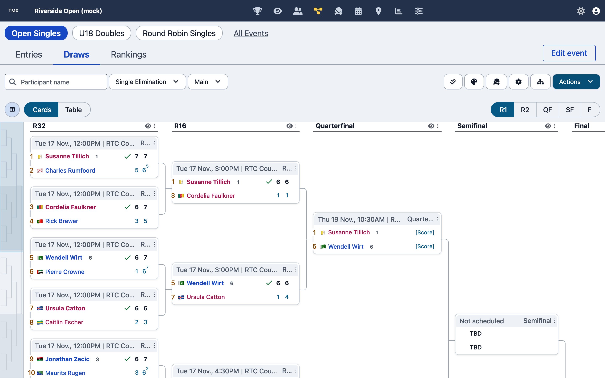
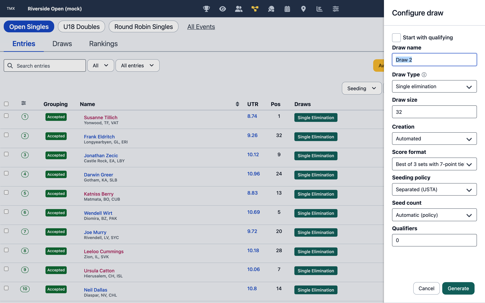
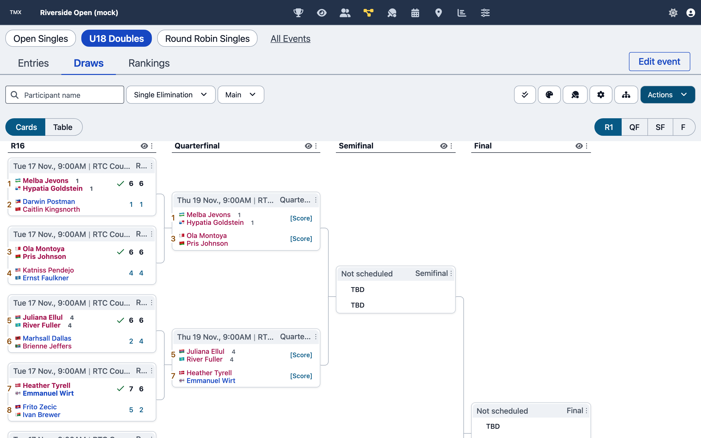
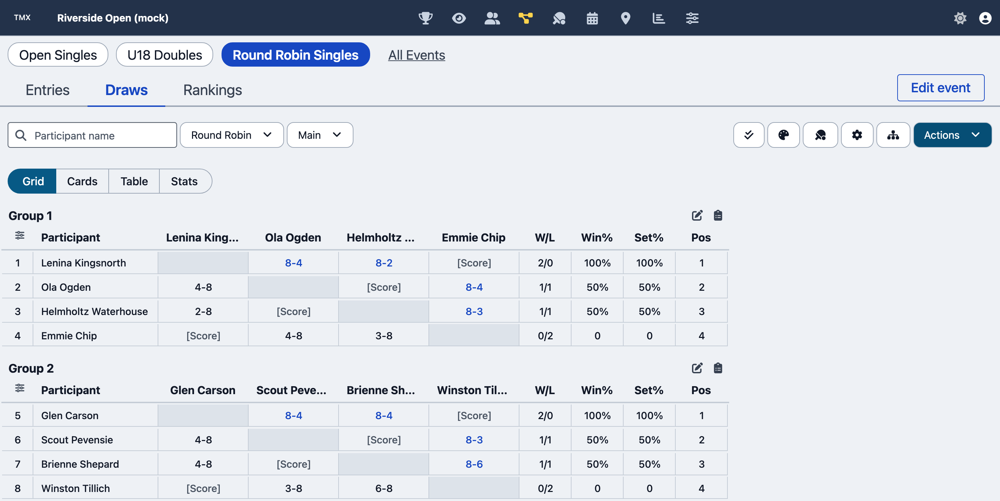

# Draw Generation and Management in TMX

The Draws interface in TMX provides comprehensive tools for generating, visualizing, and managing draw structures. This demonstrates the full power of the [Draws Governor](../governors/draws-governor.md) and related draw management methods.



_A 32-draw single elimination structure on an event's **Draws** tab. Completed matchUps show scores and a tick beside the winner; a matchUp that is ready to play shows **[Score]**. The round buttons at top right jump between rounds, and **Cards / Table** switches the layout._

The screenshots on this page show TMX running locally with a tournament generated by the factory's `mocksEngine`; every participant is a generated mock person.

## Overview

Draw management in TMX includes:

- **Draw Generation** - Multiple draw types and formats
- **Seeding** - A seeding policy and seed count in the Configure draw drawer, plus manual seed overrides
- **Position Assignment** - Manual and automatic participant placement
- **Byes Management** - Automatic and manual bye placement
- **Qualification** - Qualifying draw integration
- **Lucky Losers** - Integration of qualifying players
- **Bracket Visualization** - Interactive draw display
- **Draw Modification** - Editing positions, swapping players, adding/removing participants

## Factory Methods Used

These examples use factory engine methods. TMX's UI helpers are separate application code.
A generated draw is returned to the caller; attach it explicitly before issuing mutations by draw ID.

### Creating Draws



_The **Configure draw** drawer, opened with **Add draw** from the Entries tab: draw name, draw type, draw size, automated or manual creation, score format, seeding policy, seed count and qualifiers. **Generate** creates the draw._

```js
const { drawDefinition, error } = tournamentEngine.generateDrawDefinition({
  eventId,
  drawSize: 32,
  drawType: 'SINGLE_ELIMINATION',
  automated: false,
  seedsCount: 8,
});
if (error) throw new Error(error.message);
if (!drawDefinition) throw new Error('Draw generation failed');
const result = tournamentEngine.addDrawDefinition({ eventId, drawDefinition });
if (result.error) throw new Error(result.error.message);
const drawId = drawDefinition.drawId;
const structureId = drawDefinition.structures?.[0]?.structureId;
if (!structureId) throw new Error('Missing main structure');
```

### Seeding Participants

```js
// Set a displayed seed on an existing participant in this structure.
tournamentEngine.modifySeedAssignment({ drawId, structureId, participantId, seedValue: '1' });
// Position the seeded and unseeded entries using the chosen positioning policy.
tournamentEngine.automatedPositioning({ drawId, structureId });
```

`seedNumber` identifies an assignment; `seedValue` is its display value. For ranked automatic seeding,
see the [Seeding Policy](../policies/seedingPolicy.md). Participant scale items are not seed assignments.

### Position Assignment

```js
for (const assignment of assignments) {
  const result = tournamentEngine.assignDrawPosition({ drawId, structureId, ...assignment });
  if (result.error) throw new Error(result.error.message);
}
```

Review position actions and errors before changing a draw in play.

## Draw Types

TMX supports all factory draw types:

### Single Elimination



_A 16-draw doubles single elimination structure: each side is a pair, seeded pairs carry their seed number, and the header of each matchUp shows its scheduled day, time and court._

```js
{
  drawType: 'SINGLE_ELIMINATION',
  drawSize: 32,
  seedingProfile: 'WATERFALL'
}
```

### Compass Draw

```js
{
  drawType: 'COMPASS',
  drawSize: 16,
  compassDirection: 'EAST' // EAST, WEST, NORTH, SOUTH, NORTHEAST, etc.
}
```

### Round Robin



_A round robin draw in **Grid** view: one results grid per group, with win/loss, win percentage, set percentage and group position columns. Unplayed cells show **[Score]**. **Cards**, **Table** and **Stats** are alternative views of the same structure._

```js
{
  drawType: 'ROUND_ROBIN',
  drawSize: 8,
  groupSize: 4
}
```

### Feed-In Championship

```js
{
  drawType: 'FEED_IN_CHAMPIONSHIP',
  drawSize: 32,
  feedPolicy: 'TOP_DOWN'
}
```

### Curtis Consolation

```js
{
  drawType: 'FIRST_MATCH_LOSER_CONSOLATION',
  drawSize: 16
}
```

### Modified Feed-In

```js
{
  drawType: 'MODIFIED_FEED_IN_CHAMPIONSHIP',
  drawSize: 32
}
```

## Seeding Profiles

These are the factory's `seedingProfile` values. TMX's Configure draw drawer exposes two of them through its **Seeding policy** select: **Separated (USTA)** is `SEPARATE` and **Adjacent (ITF)** is `CLUSTER`. A provider can lock the policy, and then the select offers only the provider's. `WATERFALL` is available through the factory API only.

### Waterfall (Traditional)

```js
{
  seedingProfile: 'WATERFALL',
  seedsCount: 8
}
// Seeds: 1, 2, 3-4, 5-8, 9-16, etc.
```

### Separate

```js
{
  seedingProfile: 'SEPARATE',
  seedsCount: 8
}
// Maximizes separation of seeds
```

### Cluster

```js
{
  seedingProfile: 'CLUSTER',
  seedsCount: 8
}
// Groups seeds in same section
```

## Key Features

### Automated Draw Generation

Complete draw generation in one call:

```js
const result = tournamentEngine.generateDrawDefinition({
  eventId,
  drawSize: 32,
  drawType: 'SINGLE_ELIMINATION',
  seedingProfile: 'WATERFALL',
  automated: true,
  seedsCount: 8,
  matchUpFormat: 'SET3-S:6/TB7',
});

// Returns complete draw with:
// - Seeds positioned
// - Unseeded players positioned
// - Byes placed automatically
// - MatchUps created
```

### Manual Draw Control

Generate with `automated: false`, attach the returned definition, then assign seeds and positions as
above. Use `getPositionAssignments({ drawId, structureId })` to inspect empty, BYE and occupied slots.
Qualifying structures belong to the same draw; see [Draw Links](../concepts/draw-links.mdx) for the
link model and [Draws Governor](../governors/draws-governor.md) for qualifying attachment parameters.

### Lucky Loser Assignment

Use [position actions](../concepts/actions.mdx) to discover which replacements are legal for a
specific position. There is no draw-wide lucky-loser availability query.

```js
const result = tournamentEngine.luckyLoserDrawPositionAssignment({
  drawId,
  structureId,
  drawPosition,
  luckyLoserParticipantId: participantId,
});
if (result.error) throw new Error(result.error.message);
```

## UI Components

TMX builds this tab from these [courthive-components](https://courthive.github.io/courthive-components/) exports:

- **renderStructure** and **renderContainer** - the bracket and round robin displays
- **TopologyBuilderControl** - the draw builder, where a draw's structures and links are designed before generation
- **getMatchUpFormatModal** - the score format chosen in the Configure draw drawer
- **mountRoundProfileEditor** - the number of matchUps in each round, for the draw types that take a round profile
- **buildDrawCard** and **mapDrawDefinitionToCardData** - the draw cards
- **buildStructureMinimap** - the overview of a draw's structures

The **Configure draw** drawer itself is TMX code built with **renderForm**; it is a single drawer, not a wizard.

## Common Workflows

### Complete Draw Generation

```js
const { event } = tournamentEngine.getEvent({ eventId });
const mainEntries = (event.entries ?? []).filter((entry) => entry.entryStage === 'MAIN');
const drawSize = Math.max(2, 2 ** Math.ceil(Math.log2(mainEntries.length || 1)));
const { drawDefinition, error } = tournamentEngine.generateDrawDefinition({
  eventId,
  drawSize,
  drawType: 'SINGLE_ELIMINATION',
  automated: true,
  seedsCount: Math.min(8, Math.floor(drawSize / 4)),
  matchUpFormat: 'SET3-S:6/TB7',
});
if (error) throw new Error(error.message);
if (!drawDefinition) throw new Error('Draw generation failed');
tournamentEngine.addDrawDefinition({ eventId, drawDefinition });
```

The UI must select the intended entry statuses/stage and seeds before generation. Preview the returned
definition before replacing a published or already-played draw.

### Draw Modification

```js
// Swap two participants
tournamentEngine.swapDrawPositionAssignments({
  eventId,
  drawId,
  structureId,
  drawPositions: [1, 32], // Swap positions 1 and 32
});

// Remove participant and replace with bye
tournamentEngine.removeDrawPositionAssignment({
  eventId,
  drawId,
  structureId,
  drawPosition: 5,
});

tournamentEngine.assignDrawPositionBye({
  eventId,
  drawId,
  structureId,
  drawPosition: 5,
});

// Add alternate to draw
tournamentEngine.alternateDrawPositionAssignment({
  eventId,
  drawId,
  structureId,
  drawPosition: 10,
  participantId: alternateId,
});
```

### Multi-Flight Draw Generation

```js
// Get flight profile
const { flightProfile } = tournamentEngine.getFlightProfile({ eventId });

// Generate draw for each flight
flightProfile.flights.forEach((flight) => {
  // Get entries for this flight
  const flightEntries = getFlightEntries(eventId, flight.flightNumber);

  // Generate draw
  tournamentEngine.generateDrawDefinition({
    eventId,
    drawSize: flight.drawSize,
    drawType: 'SINGLE_ELIMINATION',
    seedingProfile: 'WATERFALL',
    automated: true,
    drawName: flight.flightName,
  });
});
```

## Draw Queries

```js
// Get all draws for event
const { event } = tournamentEngine.getEvent({ eventId });
const drawDefinitions = event.drawDefinitions ?? [];

// Get specific draw details
const { drawDefinition } = tournamentEngine.getEvent({
  eventId,
  drawId,
});

// Get draw structure
const { structures } = tournamentEngine.getDrawStructures({
  eventId,
  drawId,
});

// Get position assignments
const { positionAssignments } = tournamentEngine.getPositionAssignments({
  eventId,
  drawId,
  structureId,
});

// Check draw validity
const { valid, inconsistencies, error } = tournamentEngine.getDrawInconsistencies({
  eventId,
  drawId,
});
```

## Best Practices

### Draw Planning

- Calculate appropriate draw size (next power of 2)
- Consider bye placement for smaller fields
- Plan seeding before generation
- Decide on seeding profile based on competition level

### Seeding

- Use rankings/ratings when available
- Apply federation seeding rules
- Validate seed counts (typically 25-33% of draw size)
- Separate seeds appropriately

### Generation Strategy

- Use automated generation when possible
- Manual construction for special requirements
- Test draw validity before finalizing
- Provide preview before commitment

### Modification Caution

- Avoid changes after play begins
- Document all manual changes
- Validate draw after modifications
- Check matchUp integrity after swaps

### Performance

- Generate draws in batches for multiple events
- Cache draw definitions
- Use efficient queries for position data
- Minimize regeneration operations

## Related Documentation

- [Draws Governor](../governors/draws-governor.md) - All draw-related methods
- [Draw Concepts](../concepts/draws-overview.mdx) - Draw types and structures
- [Seeding Concepts](../policies/positioningSeeds.mdx) - Seeding policies and profiles
- [Position Actions](../concepts/actions.mdx) - Valid position operations

## Next Steps

Once draws are generated and finalized, proceed to [MatchUps](./matchups.md) to manage scoring and match progression.
