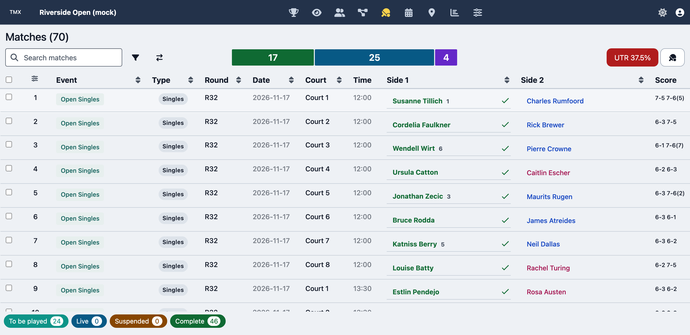
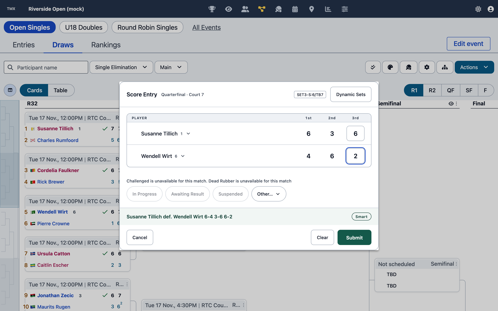
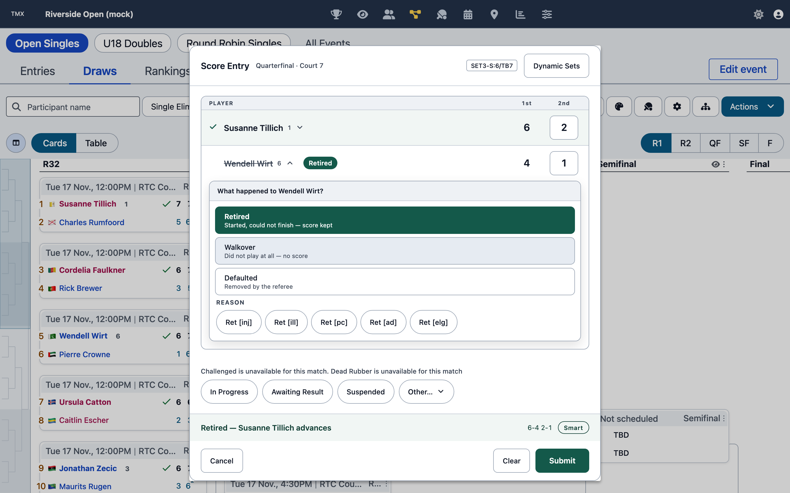

import BrowserOnly from '@docusaurus/BrowserOnly';
import ScoreEntryDemo from '../components/ScoreEntryDemo';

# MatchUp Management and Scoring in TMX

The MatchUps tab in TMX provides comprehensive match management including scoring, status updates, and match progression. This demonstrates the [Matchup Governor](../governors/matchup-governor.md) and [Score Governor](../governors/score-governor.md) capabilities.



_The MatchUps tab: every matchUp in the tournament with its event, round, scheduled date, court and time, both sides and the score. The winner of a completed matchUp is ticked, and the strip at the bottom counts matchUps by status._

The screenshots on this page show TMX running locally with a tournament generated by the factory's `mocksEngine`; every participant is a generated mock person.

## Overview

MatchUp management in TMX includes:

- **Match Listing** - View all matches with filtering and sorting
- **Live Scoring** - Enter and update match scores
- **Score Validation** - Format-aware score validation
- **Match Status** - Manage match states (scheduled, in progress, completed)
- **Match Formats** - Flexible scoring formats
- **Walkover/Retirement** - Handle special match outcomes
- **Score Display** - Tournament-style score presentation
- **Match Progression** - Automatic winner advancement

## Factory Methods Used

### Retrieving MatchUps

```js
// Get all matchUps for an event
const { matchUps } = tournamentEngine.allEventMatchUps({ eventId });

// Get matchUps for a draw
const { matchUps } = tournamentEngine.allDrawMatchUps({ drawId });

// Get matchUps for a round (getRoundMatchUps groups matchUps you pass it; it does not fetch them)
const { matchUps } = tournamentEngine.allTournamentMatchUps({
  matchUpFilters: { drawIds: [drawId], structureIds: [structureId], roundNumbers: [1] },
});

// Get specific matchUp
const { matchUp } = tournamentEngine.findMatchUp({
  eventId,
  matchUpId,
});
```

### Setting Scores

TMX enters scores through the score entry dialog from
[courthive-components](https://courthive.github.io/courthive-components/) (`openScoreEntryDialog`). The demo below
is that same component, running live in this page. On submit, the dialog reports an `outcome` in the shape
`setMatchUpStatus` reads, which is shown beneath the button.

<BrowserOnly>{() => <ScoreEntryDemo />}</BrowserOnly>



_The same dialog in TMX, opened by clicking **[Score]** on a matchUp in a draw. The header carries the round, court and matchUpFormat; the band above the buttons states the result that **Submit** will record._

```js
// Set match outcome with score
tournamentEngine.setMatchUpStatus({
  eventId,
  drawId,
  matchUpId,
  outcome: {
    score: {
      sets: [
        { side1Score: 6, side2Score: 4 },
        { side1Score: 6, side2Score: 3 },
      ],
    },
    winningSide: 1,
  },
});

// Score from string: outcome has no scoreString attribute (it would be ignored, and the matchUp completed with no
// score); build the outcome from the string first
const { outcome } = tournamentEngine.generateOutcomeFromScoreString({ scoreString: '6-4 6-3', winningSide: 1 });
tournamentEngine.setMatchUpStatus({ drawId, matchUpId, outcome });
```

### Match Status Management

```js
// Update match status: the status goes in the outcome (a top-level matchUpStatus is ignored)
tournamentEngine.setMatchUpStatus({
  drawId,
  matchUpId,
  outcome: { matchUpStatus: 'IN_PROGRESS' },
});

// Complete match with walkover
tournamentEngine.setMatchUpStatus({
  drawId,
  matchUpId,
  outcome: {
    matchUpStatus: 'WALKOVER',
    winningSide: 1,
  },
});

// Mark as retired
tournamentEngine.setMatchUpStatus({
  drawId,
  matchUpId,
  outcome: {
    matchUpStatus: 'RETIRED',
    winningSide: 1,
    score: {
      sets: [
        { side1Score: 6, side2Score: 2 },
        { side1Score: 3, side2Score: 5 },
      ],
    },
  },
});
```

### Match Formats

```js
// Set default format for event
tournamentEngine.setMatchUpFormat({
  eventId,
  matchUpFormat: 'SET3-S:6/TB7',
});

// Set format for specific structure
tournamentEngine.setMatchUpFormat({
  eventId,
  drawId,
  structureId,
  matchUpFormat: 'SET3-S:6/TB7',
});

// Set format for individual matchUp
tournamentEngine.setMatchUpFormat({
  eventId,
  matchUpId,
  matchUpFormat: 'SET1-S:8/TB7',
});
```

## Match Format Codes

TMX supports flexible match format codes:

### Standard Formats

```js
'SET3-S:6/TB7'; // Best of 3 sets to 6 games, tiebreak to 7 at 6-6
'SET3-S:6/TB7@5'; // Best of 3, tiebreak played at 5-5 (@ sets where the tiebreak starts; the default is the set's games)
'SET3-S:6/TB7-F:TB10'; // Best of 3, final set a match tiebreak to 10
'SET1-S:8/TB7'; // 1 set to 8 games, tiebreak to 7 at 8-8
'SET5-S:6/TB7'; // Best of 5 sets
```

### Timed Formats

```js
'T20'; // a 20 minute timed match (short form)
'SET1-S:T25'; // a 25 minute timed set, long form
```

### Pro Set

```js
'SET1-S:8/TB7'; // Pro set to 8
'SET1-S:10/TB7'; // Pro set to 10
```

### No-Ad Scoring

```js
'SET3-S:6NOAD/TB7'; // Best of 3, no-ad games (NOAD qualifies the set, before the tiebreak)
```

## Key Features

### Score Entry

```js
// Progressive score entry
const score = {
  sets: [],
};

// First set
score.sets.push({ side1Score: 6, side2Score: 4 });

// Second set with tiebreak
score.sets.push({
  side1Score: 7,
  side2Score: 6,
  side1TiebreakScore: 7,
  side2TiebreakScore: 5,
});

// Third set (if needed)
if (setsWon1 === 1 && setsWon2 === 1) {
  score.sets.push({ side1Score: 6, side2Score: 3 });
}

// Submit score
tournamentEngine.setMatchUpStatus({
  drawId,
  matchUpId,
  outcome: {
    score,
    winningSide: determinWinner(score),
  },
});
```

### Score Validation

```js
// Validate score matches format
const { valid, errors } = tournamentEngine.validateScore({
  matchUpFormat: 'SET3-S:6/TB7',
  score: {
    sets: [
      { side1Score: 6, side2Score: 4 },
      { side1Score: 7, side2Score: 5 },
    ],
  },
});

if (!valid) {
  console.error('Invalid score:', errors);
}
```

### Match Progression

```js
// Setting a score automatically:
// 1. Updates winner/loser
// 2. Advances winner to next round
// 3. Updates matchUp status
// 4. Triggers dependent matchUps
// 5. Updates standings (for Round Robin)

tournamentEngine.setMatchUpStatus({
  drawId,
  matchUpId,
  outcome: {
    score: {
      sets: [/* ... */],
    },
    winningSide: 1,
  },
});

// Check what matchUps are now ready
const { matchUps } = tournamentEngine.allEventMatchUps({
  eventId,
  matchUpFilters: { matchUpStatuses: ['TO_BE_PLAYED'] },
});
```

### Special Outcomes



_Clicking a player's name asks what happened to that side: **Retired**, **Walkover** or **Defaulted**. With a scoring policy that defines `matchUpStatusCodes` attached, a **Reason** row offers that policy's codes for the chosen status._

From factory 8.0.0 the chosen reason is reported keyed, as `outcome.sideStatusCodes` (or `outcome.matchUpStatusCode`
for an ending that belongs to the match); 7.x reported it as the positional `outcome.matchUpStatusCodes`. The codes come from the scoring
policy attached to the tournament or event; without one, the dialog draws no reason control. Try it in the
[live demo above](#setting-scores), which uses the factory's `POLICY_SCORING_USTA` fixture.

```js
// Walkover
tournamentEngine.setMatchUpStatus({
  drawId,
  matchUpId,
  outcome: {
    matchUpStatus: 'WALKOVER',
    winningSide: 1,
  },
});

// Default
tournamentEngine.setMatchUpStatus({
  drawId,
  matchUpId,
  outcome: {
    matchUpStatus: 'DEFAULTED',
    winningSide: 1,
  },
});

// Double walkover
tournamentEngine.setMatchUpStatus({
  drawId,
  matchUpId,
  outcome: {
    matchUpStatus: 'DOUBLE_WALKOVER',
  },
});

// Retired
tournamentEngine.setMatchUpStatus({
  drawId,
  matchUpId,
  outcome: {
    matchUpStatus: 'RETIRED',
    winningSide: 1,
    score: {
      sets: [
        { side1Score: 6, side2Score: 2 },
        { side1Score: 3, side2Score: 4 }, // Score when retired
      ],
    },
  },
});
```

## UI Components

TMX builds this tab from these [courthive-components](https://courthive.github.io/courthive-components/) exports:

- **openScoreEntryDialog** - format-aware score entry
- **renderScorecard** - a team matchUp's scorecard
- **getMatchUpFormatModal** - a matchUp's format ([see in docs](../concepts/matchup-overview.md))
- **buildCompetitivenessBar** and **buildSegmentedBar** - the competitiveness and status summaries above the table
- **controlBar** - the toolbar above the matchUps table

The matchUps table itself is a [Tabulator](https://tabulator.info/) grid in TMX's own code.

## Common Workflows

### Basic Score Entry

```js
// 1. Get matchUp
const { matchUp } = tournamentEngine.findMatchUp({
  eventId,
  matchUpId,
});

// 2. Validate participants present
if (!matchUp.sides[0].participantId || !matchUp.sides[1].participantId) {
  console.error('MatchUp not ready for scoring');
  return;
}

// 3. Enter score
const score = {
  sets: [
    { side1Score: 6, side2Score: 4 },
    { side1Score: 6, side2Score: 3 },
  ],
};

// 4. Determine winner
const winningSide = score.sets.filter((s) => s.side1Score > s.side2Score).length > 1 ? 1 : 2;

// 5. Submit
const result = tournamentEngine.setMatchUpStatus({
  drawId,
  matchUpId,
  outcome: { score, winningSide },
});

// 6. Update UI
if (result.success) {
  refreshMatchUpDisplay();
}
```

### Live Score Updates

```js
// Update score during match
let currentScore = { sets: [] };

function updateSet(setNumber, side1Score, side2Score) {
  currentScore.sets[setNumber - 1] = { side1Score, side2Score };

  // Save intermediate state: a score with no winner leaves the matchUp IN_PROGRESS
  tournamentEngine.setMatchUpStatus({
    drawId,
    matchUpId,
    outcome: {
      matchUpStatus: 'IN_PROGRESS',
      score: currentScore,
    },
  });
}

function completeMatch(winningSide) {
  tournamentEngine.setMatchUpStatus({
    drawId,
    matchUpId,
    outcome: {
      score: currentScore,
      winningSide,
      matchUpStatus: 'COMPLETED',
    },
  });
}
```

### Bulk Score Import

```js
// Import scores from external source
const scores = [
  { drawId, matchUpId: 'match1', scoreString: '6-4 6-3', winningSide: 1 },
  { drawId, matchUpId: 'match2', scoreString: '7-6(5) 4-6 6-3', winningSide: 1 },
  { drawId, matchUpId: 'match3', scoreString: 'WO', winningSide: 1, status: 'WALKOVER' },
];

scores.forEach((s) => {
  const outcome =
    s.status === 'WALKOVER'
      ? { matchUpStatus: 'WALKOVER', winningSide: s.winningSide }
      : tournamentEngine.generateOutcomeFromScoreString({ scoreString: s.scoreString, winningSide: s.winningSide })
          .outcome;

  // a score that does not fit the matchUpFormat is refused: report it rather than skipping it silently
  const result = tournamentEngine.setMatchUpStatus({
    drawId: s.drawId,
    matchUpId: s.matchUpId,
    outcome,
  });
  if (result.error) console.error(s.matchUpId, result.error);
});
```

### Score Correction

```js
// Re-enter the correct score: a new outcome replaces the old one. Changing the winner is refused once the winner has
// played on; a corrected score with the same winner is not
tournamentEngine.setMatchUpStatus({
  drawId,
  matchUpId,
  outcome: {
    score: correctScore,
    winningSide: correctWinner,
  },
});

// Or remove the outcome altogether (the CLEAR_SCORE action's payload)
tournamentEngine.setMatchUpStatus({
  drawId,
  matchUpId,
  outcome: {
    matchUpStatus: 'TO_BE_PLAYED',
    score: { scoreStringSide1: '', scoreStringSide2: '' },
    winningSide: undefined,
  },
});
```

## Filtering and Querying

```js
// Get completed matches
const { completedMatchUps } = tournamentEngine.allEventMatchUps({
  eventId,
  matchUpFilters: {
    matchUpStatuses: ['COMPLETED'],
  },
});

// Get matches ready to play
const { readyMatchUps } = tournamentEngine.allEventMatchUps({
  eventId,
  matchUpFilters: {
    matchUpStatuses: ['TO_BE_PLAYED'],
    isMatchUpTie: false,
    readyToScore: true,
  },
});

// Get matches by round
const { matchUps } = tournamentEngine.allEventMatchUps({
  eventId,
  matchUpFilters: {
    roundNumbers: [1, 2],
  },
});

// Get matches for specific participant
const { matchUps } = tournamentEngine.allEventMatchUps({
  eventId,
  inContext: true,
  contextFilters: { participantIds: [participantId] }, // participantIds is a context filter
});
```

## Statistics and Analysis

```js
// Get match statistics
const { matchUpFormat, score } = matchUp;

// Calculate total games
const totalGames = score.sets.reduce((sum, set) => sum + set.side1Score + set.side2Score, 0);

// Check for tiebreaks
const tiebreaks = score.sets.filter((set) => set.side1TiebreakScore !== undefined).length;

// Match duration
const duration =
  matchUp.schedule?.endTime && matchUp.schedule?.startTime
    ? new Date(matchUp.schedule.endTime) - new Date(matchUp.schedule.startTime)
    : null;
```

## Best Practices

### Score Entry Best Practices

- Validate format before entry
- Check for tiebreak requirements
- Verify set completion before moving to next set
- Confirm winner determination logic
- Allow score preview before submission

### Match Management

- Update status appropriately (SCHEDULED → IN_PROGRESS → COMPLETED)
- Handle special outcomes properly (WO, RET, DEF)
- Provide clear feedback on score submission
- Allow score corrections with audit trail

### Performance

- Cache matchUp lists and filter in UI
- Use matchUp filters in queries
- Batch score updates when possible
- Minimize full matchUp queries

### User Experience

- Show match format clearly
- Indicate tiebreak requirements
- Display running score during entry
- Confirm before submitting scores
- Allow easy correction of mistakes

## Related Documentation

- [Matchup Governor](../governors/matchup-governor.md) - All matchUp methods
- [Score Governor](../governors/score-governor.md) - Scoring methods
- [Match Formats](../concepts/matchup-overview.md) - Format codes and configuration
- [Match Status](../concepts/matchup-overview.md) - Status values and meanings

## Next Steps

After managing matches, proceed to [Venues & Scheduling](./venues-scheduling.md) to assign matches to courts and create schedules.
