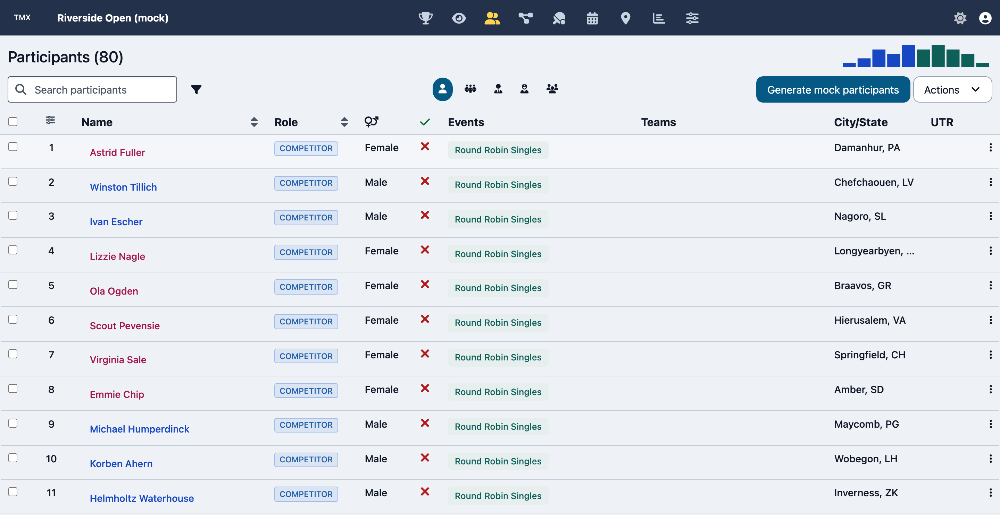
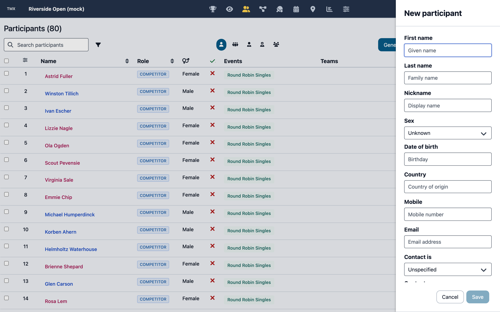
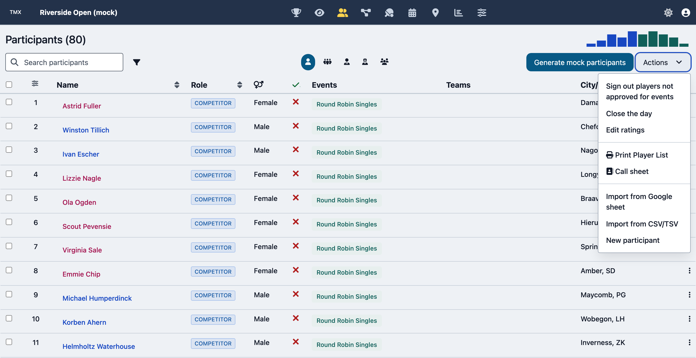

# Managing Participants in TMX

The Participants tab in TMX provides comprehensive tools for managing tournament participants, from initial registration through sign-in and assignment to events. This page demonstrates practical usage of the Competition Factory's [Participant Governor](../governors/participant-governor.md).



_The Participants tab: a searchable, sortable table of individual participants with role, sex, sign-in status, events, city/state and rating columns. The icons above the table switch between participant views; **Actions** holds the bulk operations._

The screenshots on this page show TMX running locally with a tournament generated by the factory's `mocksEngine`; every participant is a generated mock person.

## Overview

Participant management in TMX includes:

- **Registration** - Adding new participants with required and optional information
- **Import** - Bulk import from a Google Sheet or a CSV/TSV file
- **Sign-in** - Signing participants in and out as they arrive (a matchUp's check-in is the Scheduling tab's **Check-In** desk)
- **Search & Filter** - Finding participants by various criteria
- **Editing** - Updating participant information
- **Assignment** - Adding participants to events

## Factory Methods Used

The Participants feature uses these key factory methods:

### Adding Participants

```js
// Single participant
tournamentEngine.addParticipant({
  participant: {
    participantType: 'INDIVIDUAL',
    person: {
      standardGivenName: 'John',
      standardFamilyName: 'Doe',
      nationalityCode: 'USA',
    },
  },
});

// Bulk participants
tournamentEngine.addParticipants({
  participants: [/* array of participant objects */],
  allowDuplicateParticipantIdPairs: false,
});
```

### Participant Search and Retrieval

```js
// Get all participants
const { participants } = tournamentEngine.getParticipants({
  participantFilters: { participantTypes: ['INDIVIDUAL'] },
});

// Find specific participant
const { participant } = tournamentEngine.findParticipant({
  participantId,
});

// Search by name
const { participants: searchable = [] } = tournamentEngine.getParticipants();
const results = searchable.filter((p) => p.participantName?.toLowerCase().includes('john doe'));
```

### Updating Participants

```js
// Update participant details
tournamentEngine.modifyParticipant({
  participant: {
    participantId,
    person: {
      standardGivenName: 'John',
      standardFamilyName: 'Smith',
    },
  },
});

// Replace the person's contact list; retain any contacts the UI should keep.
tournamentEngine.modifyParticipant({
  participant: {
    participantId,
    person: { contacts: [{ emailAddress: 'john@example.com', mobileTelephone: '+1-555-0123' }] },
  },
});
```

## Key Features

### Registration Workflow



_Actions → **New participant** opens a drawer for adding one participant: first and last name, nickname, sex, date of birth, country, mobile and email._

1. **Participant Creation**
   - Required fields: name, participant type
   - Optional fields: nationality, contact info, rankings
   - Automatic ID generation
   - Duplicate detection

2. **Validation**
   - Name validation
   - Contact information format checking
   - Nationality code validation
   - Rating/ranking validation

3. **Storage**
   - Added to tournament record
   - Available for event assignment
   - Preserved across sessions

### Import Options



_The **Actions** menu on the Participants tab: import from a Google sheet or a CSV/TSV file, add a new participant, print the player list or a call sheet, edit ratings, and sign-out operations. **Generate mock participants** fills a tournament with generated people for testing._

#### Google Sheets Integration

```js
// TMX can import directly from Google Sheets
// Uses factory's participant structure
```

#### CSV Import

```js
// Standard CSV format
// Headers: firstName, lastName, nationality, rating, etc.
// Mapped to factory participant structure
```

### Participant Assignment

```js
// Assign participant to event
tournamentEngine.addEventEntries({
  eventId,
  participantIds: [participantId],
});

// Assign with entry status
tournamentEngine.addEventEntries({
  eventId,
  participantIds: [participantId],
  entryStatus: 'DIRECT_ACCEPTANCE',
});
```

## Participant Data Structure

TMX uses the standard factory participant structure:

```js
{
  participantId: 'uuid',
  participantType: 'INDIVIDUAL',
  participantRole: 'COMPETITOR',
  person: {
    personId: 'uuid',
    standardGivenName: 'John',
    standardFamilyName: 'Doe',
    nationalityCode: 'USA',
    sex: 'MALE'
  },
  rankings: [
    {
      rankingType: 'RATING',
      ratingType: 'UTR',
      rating: 12.5
    }
  ],
  timeItems: [
    {
      itemType: 'CHECK_IN',
      itemValue: '2024-01-15T09:00:00Z'
    }
  ]
}
```

## UI Components

TMX builds this tab from these [courthive-components](https://courthive.github.io/courthive-components/) exports:

- **controlBar** - the toolbar above the participants table: search, filters and the **Actions** menu
- **renderForm** and **renderButtons** - the add and edit participant forms
- **cModal** - the dialogs those forms open in
- **renderParticipant** - a participant as TMX's table cells show it
- **buildRatingDistributionChart** - the histogram of the participants' ratings in the tab header
- **renderTeamColorsEditor** - a team's colours

The participants table itself is a [Tabulator](https://tabulator.info/) grid in TMX's own code.

## Common Patterns

### Adding a New Participant

```js
// 1. Create participant object
const participant = {
  participantType: 'INDIVIDUAL',
  person: {
    standardGivenName: firstName,
    standardFamilyName: lastName,
    nationalityCode: country,
  },
};

// 2. Add to tournament
const result = tournamentEngine.addParticipant({ participant });

// 3. Handle result
if (result.success) {
  const { participant } = result;
  // Update UI with new participant
}
```

### Bulk Import Workflow

```js
// 1. Parse import data (CSV, Sheets, etc.)
const participants = parseImportData(data);

// 2. Validate participants
const validated = participants.filter((p) => validateParticipant(p));

// 3. Add to tournament
const result = tournamentEngine.addParticipants({
  participants: validated,
});

// 4. Report results
console.log(`Added: ${result.added.length}`);
console.log(`Duplicates: ${result.duplicates.length}`);
console.log(`Errors: ${result.errors.length}`);
```

### Participant Check-in

```js
// Add check-in time item
tournamentEngine.addTimeItem({
  itemType: 'CHECK_IN',
  itemValue: new Date().toISOString(),
  participants: [{ participantId }],
});

// Query checked-in participants
const { participants } = tournamentEngine.getParticipants({
  participantFilters: {
    participantTypes: ['INDIVIDUAL'],
  },
  withScaleValues: true,
});

const checkedIn = participants.filter((p) => p.timeItems?.some((t) => t.itemType === 'CHECK_IN'));
```

## Best Practices

### Data Quality

- Use factory methods to validate before invoking remote execution

### Performance

- Use bulk operations for multiple participants
- Understand factory based filtering capbilities

## Related Documentation

- [Participant Governor](../governors/participant-governor.md) - All participant-related methods
- [Entries Concepts](../concepts/events/entries.mdx) - How participants become event entries
- [Participant Types](../concepts/participants.md) - Data structure reference

## Next Steps

Once participants are registered, proceed to [Events & Categories](./events-categories.md) to create tournament events and assign participants.
