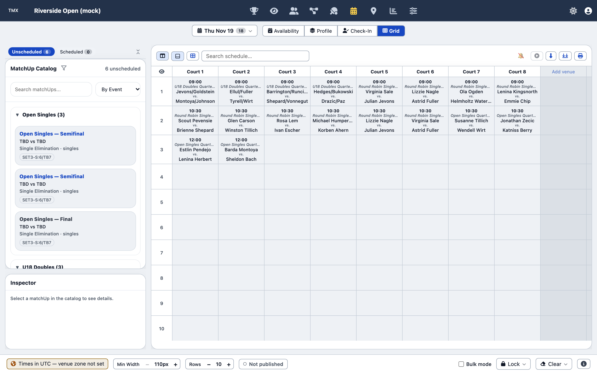
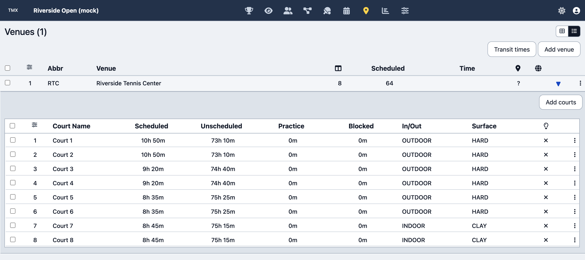
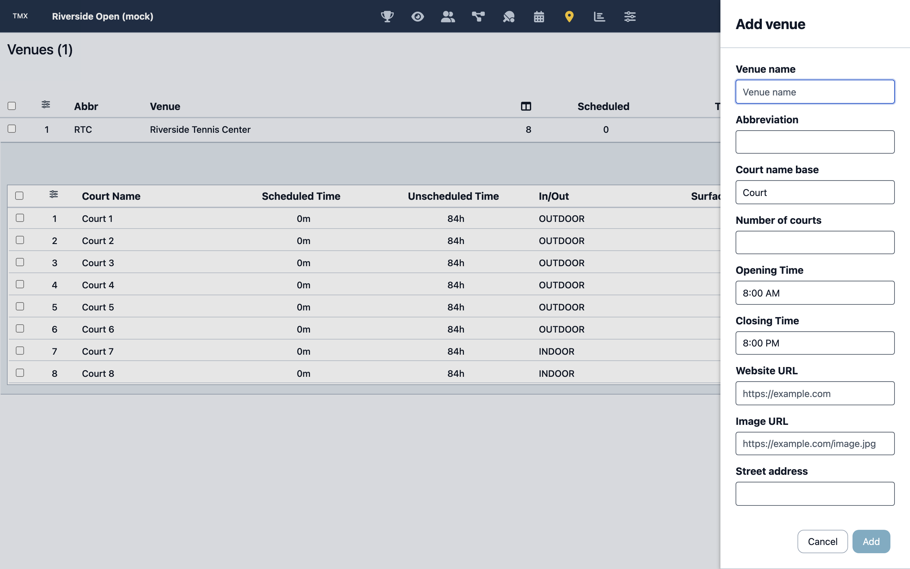

# Venues and Scheduling in TMX

The Venues and Schedule tabs in TMX provide tools for managing tournament venues, courts, and match scheduling. This demonstrates the [Venue Governor](../governors/venue-governor.md) and [Schedule Governor](../governors/schedule-governor.md) capabilities.



_The scheduling **Grid** for one day: a column per court and a row per order of play, with each scheduled matchUp showing its time, event and round, and sides. The **MatchUp Catalog** on the left lists matchUps that are not yet on the grid._

The screenshots on this page show TMX running locally with a tournament generated by the factory's `mocksEngine`; every participant is a generated mock person.

## Overview

Venue and scheduling management in TMX includes:

- **Venue Creation** - Define tournament venues with court details
- **Court Configuration** - Surface types, dimensions, and attributes
- **Match Scheduling** - Assign matches to courts and times
- **Schedule Optimization** - Auto-scheduling with constraints
- **Scheduling Modes** - The Scheduling tab has four: **Availability** (court hours), **Profile** (the [scheduling profile](../concepts/scheduling-profile.mdx)), **Check-In** (the matchUp check-in desk) and **Grid** (the day's order of play by court). A fifth, **Plan**, stages alternative schedules and is a beta behind a feature flag.
- **Order of Play** - Generate and publish schedules
- **Schedule Modifications** - Move matches, handle delays
- **Resource Management** - Court availability and booking

## Factory Methods Used

### Managing Venues



_The Venues tab with a venue row expanded to list its courts. **Add venue** and **Add courts** open the corresponding drawers._

```js
// Add venue
tournamentEngine.addVenue({
  venue: {
    venueName: 'Main Stadium',
    venueAbbreviation: 'MS',
    courts: [
      {
        courtName: 'Court 1',
        surfaceCategory: 'HARD',
        courtDimensions: 'STANDARD',
      },
    ],
  },
});

// Add court to existing venue
tournamentEngine.addCourt({
  venueId,
  court: {
    courtName: 'Court 2',
    surfaceCategory: 'CLAY',
  },
});

// Modify venue
tournamentEngine.modifyVenue({
  venueId,
  venue: {
    venueName: 'Stadium Court',
    venueAbbreviation: 'SC',
  },
});
```

### Scheduling MatchUps

Use `bulkScheduleMatchUps` for explicit placements. Each detail carries its own `schedule`; the
engine resolves tournament context from the matchUp ID and reports missing/locked/skipped IDs.
`scheduledDuration` is not an explicit placement field; configure expected durations in scheduling
policy when using an automatic scheduler.

```js
const result = tournamentEngine.bulkScheduleMatchUps({
  matchUpDetails: [
    { matchUpId: id1, schedule: { venueId, courtId, scheduledDate: '2024-06-15', scheduledTime: '09:00' } },
    { matchUpId: id2, schedule: { venueId, courtId, scheduledDate: '2024-06-15', scheduledTime: '10:30' } },
  ],
});
if (result.error) throw new Error(result.error.message);
```

### Auto-Scheduling

Configure court availability and attach a [scheduling profile](../concepts/scheduling-profile.mdx)
that identifies the tournament, event, draw, structure and rounds for each date/venue. The scheduler
uses that profile; event IDs and start/end times alone do not define one.

```js
// schedulingProfile is the reviewed date/venue/round profile built by the UI.
tournamentEngine.setSchedulingProfile({ schedulingProfile });
const result = tournamentEngine.scheduleProfileRounds({
  scheduleDates: ['2024-06-15', '2024-06-16'],
});
if (result.error) throw new Error(result.error.message);
```

### Schedule Queries

```js
// Get venue details
const { venues } = tournamentEngine.getVenuesAndCourts();

// Get courts for venue
const { courts } = tournamentEngine.getCourts({ venueId });

// Get scheduled matchUps
const { dateMatchUps } = tournamentEngine.competitionScheduleMatchUps({
  matchUpFilters: { scheduledDate: '2024-06-15' },
});

// Get court schedule
const { matchUps: courtMatchUps } = tournamentEngine.allTournamentMatchUps({
  matchUpFilters: { courtIds: [courtId], scheduledDate: '2024-06-15' },
});
```

## Key Features

### Venue Management



_The **Add venue** drawer: venue name and abbreviation, the base name and number of courts to create, opening and closing times, and optional website, image and address details._

```js
// Complete venue with multiple courts
const venue = {
  venueName: 'Tennis Club',
  venueAbbreviation: 'TC',
  courts: [
    {
      courtName: 'Stadium Court',
      surfaceCategory: 'HARD',
      courtDimensions: 'STANDARD',
      altitude: 100,
      latitude: 40.7128,
      longitude: -74.006,
      indoor: false,
      onlineResources: [
        {
          resourceType: 'URL',
          resourceSubType: 'LIVESTREAM',
          identifier: 'https://stream.example.com/court1',
        },
      ],
    },
    {
      courtName: 'Court 2',
      surfaceCategory: 'CLAY',
      indoor: true,
    },
    {
      courtName: 'Court 3',
      surfaceCategory: 'GRASS',
    },
  ],
};

tournamentEngine.addVenue({ venue });
```

### Court Attributes

TMX supports various court attributes:

```js
// Surface categories
'HARD', 'CLAY', 'GRASS', 'CARPET', 'ARTIFICIAL_CLAY', 'ARTIFICIAL_GRASS'

// Court dimensions
'STANDARD', 'JUNIOR', 'MINI'

// Additional attributes
{
  indoor: boolean,
  altitude: number, // meters above sea level
  courtId: string,
  courtName: string,
  surfaceCategory: string,
  surfaceType: string, // e.g., 'Plexipave', 'Red clay'
  surfaceDate: string, // When surface was last updated
  pace: number, // Court pace rating
  notes: string
}
```

### Schedule Patterns

#### Simple Time Slots

```js
const slots = [
  { time: '09:00', duration: 90 },
  { time: '10:30', duration: 90 },
  { time: '12:00', duration: 90 },
  { time: '14:00', duration: 90 },
  { time: '15:30', duration: 90 },
  { time: '17:00', duration: 90 },
];
```

#### Court Rotation

```js
// Assign matches across courts evenly
const courts = await tournamentEngine.getCourts({ venueId });
const matchUps = await tournamentEngine.allEventMatchUps({ eventId });

let courtIndex = 0;
matchUps.forEach((matchUp) => {
  const court = courts[courtIndex % courts.length];
  scheduleMatchUp(matchUp, court);
  courtIndex++;
});
```

#### Round-Based Scheduling

```js
// Schedule round 1 on day 1, round 2 on day 2, etc.
const { matchUps } = tournamentEngine.allEventMatchUps({ eventId });

const byRound = matchUps.reduce((acc, m) => {
  const round = m.roundNumber;
  if (!acc[round]) acc[round] = [];
  acc[round].push(m);
  return acc;
}, {});

Object.entries(byRound).forEach(([round, matches], index) => {
  const date = addDays(startDate, index);
  scheduleRound(matches, date);
});
```

### Schedule Times

```js
// Add schedule with time
tournamentEngine.bulkScheduleMatchUps({
  matchUpDetails: [
    {
      matchUpId,
      schedule: {
        scheduledDate: '2024-06-15',
        scheduledTime: '14:00',
        courtId,
        venueId,
      },
    },
  ],
});

// Add actual times
tournamentEngine.addMatchUpScheduleItems({
  matchUpId,
  schedule: {
    startTime: '2024-06-15T14:05:00Z',
    endTime: '2024-06-15T15:42:00Z',
  },
});
```

### Schedule Constraints

```js
// Check participant availability
function canSchedule(matchUp, time) {
  const participants = [matchUp.side1, matchUp.side2];

  // Check for conflicts
  for (const participant of participants) {
    const schedule = getParticipantSchedule(participant.participantId);
    if (hasConflict(schedule, time)) {
      return false;
    }
  }

  return true;
}

// Minimum rest time
const REST_TIME = 60; // minutes

function hasAdequateRest(participantId, proposedTime) {
  const lastMatch = getLastMatch(participantId);
  if (!lastMatch) return true;

  const timeSince = proposedTime - lastMatch.endTime;
  return timeSince >= REST_TIME;
}
```

## UI Components

TMX builds this tab from these [courthive-components](https://courthive.github.io/courthive-components/) exports:

- **createAvailabilityGrid** and **showCourtAvailabilityModal** - Availability mode: court hours
- **createSchedulingProfile** - Profile mode: rounds placed on dates and venues
- **createSchedulePage**, **buildScheduleGridCell** and **buildActiveStripPanel** - Grid mode: the order of play, the MatchUp Catalog and the strip of courts in play
- **buildVenueCard** and **mapVenueToCardData** - the venue cards
- **buildCourtCard** and **mapCourtToCardData** - the court cards

## Common Workflows

### Complete Scheduling Setup

```js
// 1. Create venue with courts
const { venue } = tournamentEngine.addVenue({
  venue: {
    venueName: 'Main Club',
    courts: [
      { courtName: 'Court 1', surfaceCategory: 'HARD' },
      { courtName: 'Court 2', surfaceCategory: 'HARD' },
      { courtName: 'Court 3', surfaceCategory: 'CLAY' },
    ],
  },
});

// 2. Get matchUps to schedule
const { matchUps } = tournamentEngine.allEventMatchUps({
  eventId,
  matchUpFilters: {
    matchUpStatuses: ['TO_BE_PLAYED'],
    readyToScore: true,
  },
});

// 3. Generate schedule
const scheduleDate = '2024-06-15';
const startTime = '09:00';
const matchDuration = 90;

const matchUpDetails = [];
let currentTime = startTime;
let courtIndex = 0;

matchUps.forEach((matchUp) => {
  const court = venue.courts[courtIndex % venue.courts.length];

  matchUpDetails.push({
    matchUpId: matchUp.matchUpId,
    schedule: {
      venueId: venue.venueId,
      courtId: court.courtId,
      scheduledDate: scheduleDate,
      scheduledTime: currentTime,
    },
  });

  // Move to next time slot when all courts are filled
  if ((courtIndex + 1) % venue.courts.length === 0) {
    currentTime = addMinutes(currentTime, matchDuration);
  }

  courtIndex++;
});

// 4. Apply schedule
tournamentEngine.bulkScheduleMatchUps({ matchUpDetails });
```

### Order of Play Generation

```js
// Get all matches for a date
const { dateMatchUps } = tournamentEngine.competitionScheduleMatchUps({
  matchUpFilters: { scheduledDate: '2024-06-15' },
});

// Group by court
const byCourt = dateMatchUps.reduce((acc, matchUp) => {
  const courtId = matchUp.schedule.courtId;
  if (!acc[courtId]) acc[courtId] = [];
  acc[courtId].push(matchUp);
  return acc;
}, {});

// Sort by time within each court
Object.keys(byCourt).forEach((courtId) => {
  byCourt[courtId].sort((a, b) => a.schedule.scheduledTime.localeCompare(b.schedule.scheduledTime));
});

// Generate order of play document
const orderOfPlay = {
  date: '2024-06-15',
  courts: Object.entries(byCourt).map(([courtId, matches]) => ({
    court: getCourt(courtId),
    matches: matches.map((m) => ({
      time: m.schedule.scheduledTime,
      event: getEvent(m.eventId).eventName,
      round: m.roundName,
      participants: formatParticipants(m.sides),
    })),
  })),
};
```

### Handling Schedule Changes

```js
// Move match to different court
tournamentEngine.bulkScheduleMatchUps({
  matchUpDetails: [
    {
      matchUpId,
      schedule: {
        courtId: newCourtId,
        scheduledDate: existingDate,
        scheduledTime: existingTime,
      },
    },
  ],
});

// Reschedule to different time
tournamentEngine.bulkScheduleMatchUps({
  matchUpDetails: [
    {
      matchUpId,
      schedule: {
        courtId: existingCourtId,
        scheduledDate: existingDate,
        scheduledTime: newTime,
      },
    },
  ],
});

// Remove scheduling
tournamentEngine.clearMatchUpSchedule({
  matchUpId,
});
```

## Best Practices

### Venue Setup

- Create venues before scheduling
- Configure all courts with proper attributes
- Include surface types for filtering
- Add court dimensions for capacity planning

### Scheduling Strategy

- Schedule ready matches first
- Consider participant rest times
- Balance court usage
- Account for match duration variability
- Leave buffer time between matches

### Schedule Display

- Show by court for officials
- Show by time for participants
- Include event and round information
- Display participant names clearly
- Indicate court surface

### Modifications

- Notify affected participants of changes
- Update both scheduled and actual times
- Track schedule changes for reporting
- Validate changes before applying

## Related Documentation

- [Venue Governor](../governors/venue-governor.md) - Venue and court methods
- [Schedule Governor](../governors/schedule-governor.md) - Scheduling methods
- [Scheduling Concepts](../concepts/scheduling-overview.mdx) - Scheduling strategies
- [Tournaments Linked by Shared Venues](../concepts/venues-courts.md) - Multi-tournament venues

## Next Steps

- Learn about [Browser Console](./browser-console.md) for direct factory interaction
- Understand [Competition Factory Server](./factory-server.md) architecture
