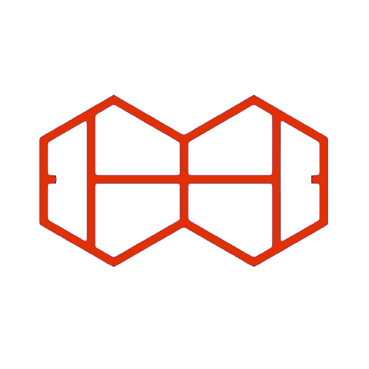

<p align="center">
  <a href="https://courthive.com/" target="_blank"></a>
</p>

# competition-factory

**An engine for creating and running competitions, in any sport that plays matches.**

- **Documentation:** <https://courthive.github.io/competition-factory/>
- **Upgrading from `tods-competition-factory`:** [Migration to 8.0.0](https://courthive.github.io/competition-factory/docs/migration-8.0.0)
- **Source and issues:** <https://github.com/CourtHive/competition-factory>

## What the factory is

The Competition Factory creates and changes tournament records: draws, entries and seeding, scheduling, scoring and
results, publishing, rankings and ratings. Every operation is a method on an engine, and every rule it applies comes
from a JSON policy rather than from code, so the same records and the same results come out wherever it runs: in a
browser, on a server, or offline.

- **Configurable.** Sensible defaults for every operation, each replaceable with your own JSON policy.
- **Runs anywhere.** Client, server or both; a complete tournament manager
  [runs in the browser](https://courthive.github.io/TMX). The server engine isolates state per request for
  asynchronous Node.js deployments.
- **Consistent.** The same configuration produces the same structures and results wherever it executes.
- **No runtime dependencies.** Built on platform APIs only.
- **Across sports.** Tennis, padel, pickleball, squash, badminton, table tennis, beach tennis, wheelchair tennis,
  volleyball and more; the sport and discipline vocabularies are open. Scoring formats are a compact, parseable
  grammar (`SET3-S:6/TB7`), so each sport's format is validated data.

## What it covers

- **Draws.** Single and double elimination, round robin (with playoffs), Swiss, feed-in championships, consolation
  formats, compass and Olympic draws, page playoffs, ladders, lucky draws, ad hoc and adaptive rounds. Structures link
  to each other by winner, loser or finishing position, so qualifying stages, consolations and new formats compose
  freely.
- **Participants, entries and seeding.** Individuals, pairs and teams; entry status, alternates and lucky losers;
  policy-driven seeding and avoidance. Position and matchUp action queries return exactly the operations a draw's
  state allows.
- **Team competition.** Dual matches described as a tie format of collections, with line-ups and team scoring.
- **Scheduling.** Automated multi-day scheduling that respects recovery times and daily limits, grid scheduling with
  conflict detection, venues, courts and availability, and practice courts.
- **Scoring.** Point-by-point scoring with undo and redo, set and game entry, and outcome determination.
- **Publishing.** Visibility at every level, with time-based embargoes in an explicit time zone.
- **Rankings and ratings.** Ranking points from results under configurable policies, multi-tournament aggregation,
  and dynamic ratings.
- **Officiating and sanctioning.** Official assignments and eligibility, and sanctioning workflows checked against
  policy.
- **Mock data.** `mocksEngine` builds complete, valid tournament records from a compact profile with seeded
  randomness.

## New in 8.0

8.0.0 is the first release under this name. It continues `tods-competition-factory`, whose 7.x releases stay
installable and are no longer maintained.

- **The factory resolves no names.** It ships its own defaults and provider-neutral presets. A named tie format or a
  policy modelled on a governing body's rules is passed in as an object, from the companion catalogue (below) or from
  your own configuration. A name passed where the object belongs is refused rather than quietly replaced by a default.
- **Status reasons are keyed by side.** A reason a side gave goes in `sideStatusCodes`, a reason that belongs to the
  match in `matchUpStatusCode`. An outcome that carries the old positional `matchUpStatusCodes` array is refused
  before anything is written.
- **Stateless tools by subpath.** Pure functions live under `tools` and are importable by domain, for example
  `competition-factory/tools/formats` or `competition-factory/tools/scoring`, without loading an engine.
- **Records from earlier releases still read.** Tournament records written by 7.x and earlier load and query
  unchanged; the migration guide describes the
  [stricter write rules](https://courthive.github.io/competition-factory/docs/migration-8.0.0#records-written-before-800).

## The competition catalogue

[`@courthive/competition-catalogue`](https://www.npmjs.com/package/@courthive/competition-catalogue) is a separate
package of plain data: named tie formats, policy templates and competition formats. The templates are modelled on
published sources as starting points to copy and own. CourtHive does not maintain them against those sources, and
the bodies they name have not endorsed them. The package imports nothing from the engine and versions independently;
a stored tournament record never needs it to be read.

```sh
npm install @courthive/competition-catalogue
```

```js
import { mocksEngine } from 'competition-factory';
import { resolveTieFormat, tieFormatConstants } from '@courthive/competition-catalogue';

const tieFormat = resolveTieFormat(tieFormatConstants.DOMINANT_DUO);
const { tournamentRecord } = mocksEngine.generateTournamentRecord({
  drawProfiles: [{ drawSize: 4, eventType: 'TEAM', tieFormat }],
});
```

## Getting started

Node.js 24 or later. TypeScript declarations ship with the package.

```sh
npm install competition-factory
```

```js
import { mocksEngine, tournamentEngine } from 'competition-factory';

const { tournamentRecord } = mocksEngine.generateTournamentRecord({
  drawProfiles: [{ drawSize: 32, drawType: 'FEED_IN_CHAMPIONSHIP' }],
});
tournamentEngine.setState(tournamentRecord);

const { matchUps } = tournamentEngine.allTournamentMatchUps();
console.log(matchUps.length); // 61: 31 in the main draw, 30 in the consolation
```

The package ships an ES module build and a CommonJS build:

```js
const { mocksEngine, tournamentEngine } = require('competition-factory');
```

A tool by subpath:

```js
import { parse } from 'competition-factory/tools/formats';

parse('SET3-S:6/TB7'); // { bestOf: 3, setFormat: { setTo: 6, tiebreakAt: 6, tiebreakFormat: { tiebreakTo: 7 } } }
```

The [documentation](https://courthive.github.io/competition-factory/) covers the engines, every governor and its
methods, policies, and the mocks engine.

## License

[MIT](https://github.com/CourtHive/competition-factory/blob/master/LICENSE)
